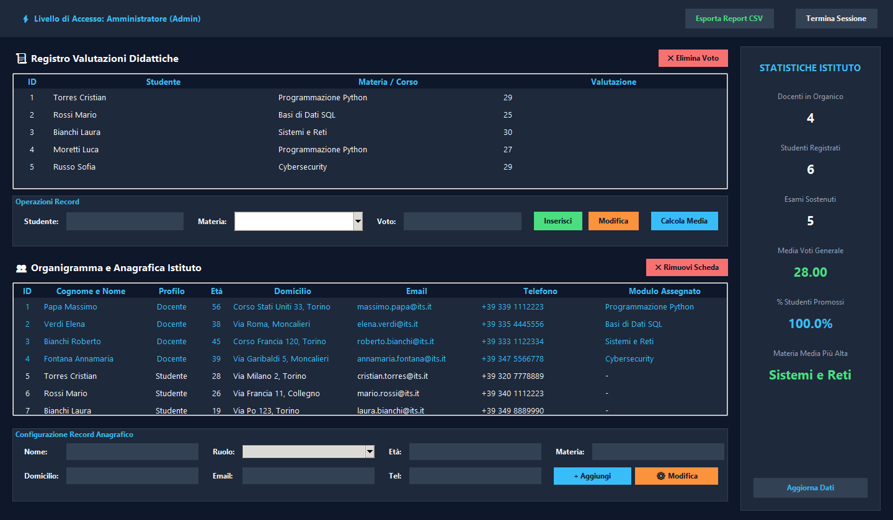
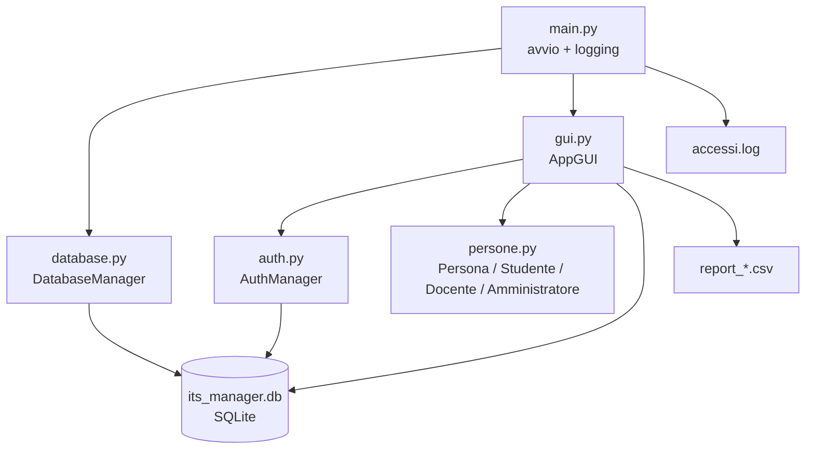
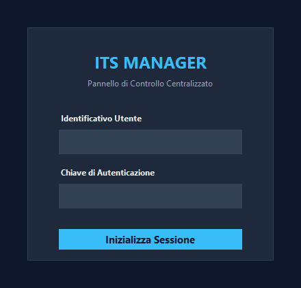

# 🎓 ITS Manager

**Gestionale desktop per la segreteria di un istituto ITS**, scritto in Python con
interfaccia **Tkinter** e database **SQLite**. Un'unica applicazione copre
autenticazione con ruoli, registro delle valutazioni, anagrafica di studenti e
docenti, statistiche dell'istituto ed esportazione dei dati in CSV.


Progetto realizzato come consegna d'esame ITS da **Cristian Torres**.



*Dashboard dopo il login come Amministratore: statistiche dell'istituto,
registro valutazioni e anagrafica.*

---

## ✨ Cosa fa

- **Login con ruoli** — accesso tramite username (o email) e password; ogni
  tentativo, riuscito o fallito, viene scritto nel file `accessi.log`.
- **Dashboard con statistiche reali** — numero di docenti e studenti, esami
  sostenuti, media generale dei voti, percentuale di valutazioni sufficienti e
  materia con la media più alta, calcolate con query aggregate sul database.
- **Registro valutazioni** — tabella interattiva con inserimento, modifica ed
  eliminazione dei voti; la materia si sceglie da una combobox popolata con i
  corsi attivi dell'istituto.
- **Anagrafica istituto** — schede di studenti e docenti con età, domicilio,
  email, telefono e modulo assegnato; l'ordinamento è uniformato in
  *COGNOME NOME*.
- **Calcolo media per studente** — riepilogo dei voti registrati e media
  aritmetica calcolata dalla classe `Studente`.
- **Export CSV** — tre report separati (anagrafica, voti, ultimi accessi) con
  separatore `;` e BOM UTF-8, pronti per Excel italiano.

---

## 🏛️ Architettura

L'applicazione è organizzata su tre livelli: interfaccia, logica di dominio e
persistenza.



| Modulo | Responsabilità |
|---|---|
| `main.py` | Configura il logging, inizializza il database e avvia la finestra Tkinter |
| `database.py` | Crea lo schema (`utenti`, `voti`, `persone`) e inserisce i dati iniziali al primo avvio |
| `auth.py` | Hash SHA-256 delle password, verifica delle credenziali, log dei tentativi |
| `persone.py` | Modello OOP con ereditarietà: `Persona` → `Studente`, `Docente`, `Amministratore` |
| `gui.py` | Login, dashboard, tabelle, form CRUD, statistiche ed export CSV |

---

## 🚀 Avvio rapido

Requisiti: **Python 3.10 o superiore** con Tkinter (incluso nell'installer
ufficiale di Windows e nei pacchetti `python3-tk` su Linux). Nessuna dipendenza
esterna: si usa solo la standard library.

```bash
git clone https://github.com/cristiantorres-star/its-manager.git
cd its-manager
python main.py
```

Al primo avvio l'applicazione crea nella cartella corrente:

- `its_manager.db` — database SQLite con schema e dati istituzionali di esempio;
- `accessi.log` — registro dei tentativi di accesso.

Per ripartire da zero basta eliminare `its_manager.db` e rilanciare: viene
ricreato e ripopolato automaticamente.

---

## 🔑 Credenziali demo

I dati iniziali vengono inseriti solo se la tabella `utenti` è vuota.

| Ruolo | Username | Password |
|---|---|---|
| Amministratore | `admin` / `admin@its.it` | `admin123` |
| Docente | es. `massimo.papa@its.it` | `docente123` |
| Studente | es. `cristian.torres@its.it` | `studente123` |

Ogni utente è registrato sia con l'email sia con il nome per esteso, quindi il
login funziona con entrambi.



*Schermata di accesso: le credenziali vengono verificate da `AuthManager` e
ogni tentativo finisce in `accessi.log`.*

---

## 👥 Ruoli e permessi

| Funzione | Amministratore | Docente | Studente |
|---|:--:|:--:|:--:|
| Consultare voti e anagrafica | ✅ | ✅ | ✅ |
| Inserire / modificare voti | ✅ | ✅ | — |
| Eliminare voti | ✅ | ✅ | — |
| Calcolare la media di uno studente | ✅ | ✅ | — |
| Esportare i report CSV | ✅ | ✅ | — |
| Gestire l'anagrafica (aggiungi / modifica / elimina) | ✅ | — | — |

L'interfaccia si adatta al ruolo: i form e i pulsanti non consentiti non vengono
proprio costruiti.

---

## 🗄️ Database

Tre tabelle relazionate per chiave logica sul nome della persona:

| Tabella | Colonne | Note |
|---|---|---|
| `utenti` | `username` (PK), `password_hash`, `ruolo` | Password salvate come hash SHA-256 |
| `persone` | `id` (PK), `nome`, `ruolo_scolastico`, `eta`, `indirizzo`, `email`, `telefono`, `materia` | `materia` valorizzata solo per i docenti |
| `voti` | `id` (PK), `studente`, `materia`, `voto` | Una riga per valutazione |

Dati iniziali: 22 account, 10 schede anagrafiche e 5 valutazioni storiche.

---

## 📁 Struttura del repository

```
its-manager/
├── README.md                    ← questa pagina
├── main.py                      punto di ingresso dell'applicazione
├── gui.py                       interfaccia Tkinter (login + dashboard)
├── auth.py                      autenticazione e log degli accessi
├── database.py                  schema SQLite e dati istituzionali
├── persone.py                   modello OOP di persone, studenti e docenti
├── screenshot_CloudShell.png    screenshot dell'ambiente Cloud Shell
├── docs/
│   ├── dashboard.png            screenshot della dashboard (rigenerabile)
│   └── login.png                screenshot della schermata di accesso
├── tools/
│   └── capture_screenshots.py   avvia l'app e cattura login e dashboard
└── .gitignore                   esclude database, log, report e cache
```

I file `its_manager.db`, `accessi.log` e `report_*.csv` sono **generati a
runtime** e non vengono versionati.

---

## 📤 Export dei report

Dalla barra superiore (ruoli Amministratore e Docente) il pulsante
**Esporta Report CSV** genera nella cartella di esecuzione:

| File | Contenuto |
|---|---|
| `report_anagrafica_<timestamp>.csv` | Nome, ruolo, età, email di tutte le persone |
| `report_voti_<timestamp>.csv` | Studente, materia, voto |
| `report_accessi_<timestamp>.csv` | Ultime 20 righe di `accessi.log` |

Formato: separatore `;`, codifica `utf-8-sig`, una sola tabella per file, così
che Excel italiano apra i CSV senza passare dall'import guidato.

---

## 📸 Rigenerare gli screenshot

Le immagini in `docs/` non sono ritagli fatti a mano: lo script
`tools/capture_screenshots.py` avvia l'applicazione e salva il contenuto della
finestra, sia per il login sia per la dashboard.

```bash
pip install pillow          # dipendenza usata solo da questo strumento
python tools/capture_screenshots.py                      # entrambe le schermate
python tools/capture_screenshots.py --view login         # solo il login
python tools/capture_screenshots.py --view dashboard --user admin --password admin123
```

Pillow non serve all'applicazione: il gestionale continua a girare con la sola
standard library. Lo script accetta `--view` (`login`, `dashboard`, `both`),
`--output`, `--login-output`, `--user`, `--password` e `--delay`, e richiede una
sessione grafica attiva (non funziona in CI headless).

---

## 🧰 Scelte tecniche

- **Solo standard library** (`tkinter`, `sqlite3`, `hashlib`, `csv`, `logging`):
  il progetto si esegue senza `pip install` e senza virtualenv.
- **Separazione delle responsabilità**: la GUI non contiene query duplicate, ma
  delega autenticazione e inizializzazione del database ai rispettivi moduli.
- **Ereditarietà reale**: `Studente`, `Docente` e `Amministratore` estendono
  `Persona` e aggiungono comportamenti propri (media voti, corsi assegnati).
- **Parametrizzazione delle query** con placeholder `?`, per evitare problemi di
  quoting e di SQL injection sui dati inseriti dall'utente.

---

## ⚠️ Limiti noti (contesto didattico)

- Le password sono hashate in SHA-256 **senza salt**: adeguato per un esercizio,
  non per un sistema reale (in produzione servirebbe `bcrypt`/Argon2).
- Le credenziali demo sono in chiaro nel codice di seed: vanno rimosse o
  sostituite prima di qualsiasi uso con dati reali.
- L'applicazione è monoutente e locale: non c'è un server, quindi non esiste
  autenticazione di rete né concorrenza tra più sessioni.
- Lo script di cattura dipende da Pillow e da un desktop: non è pensato per
  l'esecuzione automatica in un ambiente senza display.
- Gli screenshot riflettono il tema e il layout attuali: vanno rigenerati quando
  cambia la GUI, altrimenti documentano un'interfaccia che non esiste più.
